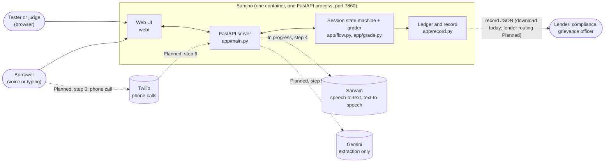
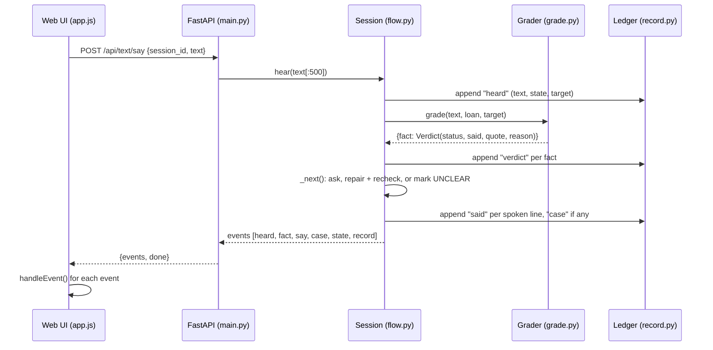
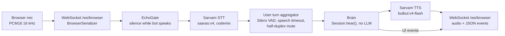

# Samjho: high-level design

Scope: the system as it exists in this repository, plus the parts still being built, each marked
**Planned** with its roadmap step ([ROADMAP.md](ROADMAP.md)). Module-level detail is in [LLD.md](LLD.md).
All loan data is synthetic.

## 1. Principle: the LLM never decides

Whether a fact is green, amber, red or grey is decided only by deterministic Python in `app/grade.py`, using
tolerances in `app/loan.py`. The conversation order is a state machine in `app/flow.py`. Spoken lines are fixed
templates in `app/lines.py`, filled from the loan.

The current code calls no LLM at all. The voice pipeline (`app/voice.py`) is built on Pipecat's LLM-style
aggregator, but its `Brain` processor sends her finished turn to `Session.hear()` and drops the LLM context
frame, so no model is asked anything. The planned Gemini extractor (step 5) may only suggest which fact a
spoken number belongs to; its output would still pass through the same `judge()` function, and if it is slow
or missing, the rules in `app/grade.py` are used. This means the same input always gets the same verdict, the
verdict can be explained from the code, and the system works with no LLM key.

## 2. Context

Solid lines exist and are working today. Dotted lines are in progress or planned.

## 3. Components

| Component | Files | Responsibility | Status |
|---|---|---|---|
| Web UI | `web/index.html`, `web/app.js`, `web/style.css` | One screen: four start tiles, language choice, transcript with English gloss, five fact chips, case notes, record card with JSON download. Renders every channel through one `handleEvent()` | Built (typing mode wired; voice, phone and replay tiles show their status; the browser microphone client is step 4) |
| FastAPI server | `app/main.py` | Serves the UI and static files, `/healthz`, `/api/status` (replay is ready only when `replays/*.json` exists), the typing-mode API, and the `/ws/browser` voice socket; holds typing sessions in memory (30-minute idle expiry, at most 200) | Built |
| Settings | `app/config.py` | Reads optional keys from the environment or `.env`; reports which features are ready and why not, never the key values | Built |
| Session state machine | `app/flow.py` | consent, explain, teachback, check, private, final_consent, done. Emits events; writes every step to the ledger | Built |
| Grader | `app/grade.py`, `app/loan.py` | Assigns spoken numbers to facts by cue words in the same clause, then judges each against the loan with tolerances | Built |
| Number parser | `app/hi_numbers.py` | Hindi, Hinglish, Devanagari, English and digit numbers to values with a confidence flag and alternatives; payment schedule, instalment count and duration. Pure functions, no I/O | Built (544 test cases) |
| Spoken lines | `app/lines.py`, `app/numwords.py` | Every line in Hindi (Devanagari, amounts as words) and English, built from the loan | Built |
| Ledger and record | `app/record.py`, `Session.record()` | Append-only hash-chained log; record with per-fact results, cases, consent and SHA-256 seal; `verify()` | Built |
| Extractor | `app/extract.py` | Gemini JSON extraction, 1.5 s timeout, rules-only fallback | Planned (step 5) |
| Browser voice channel | `app/voice.py`, `app/browser_serializer.py` | Mic audio over `/ws/browser`, Sarvam STT and TTS on Pipecat 1.17, half duplex, per-turn latency events, at most 4 live sessions | In progress (step 4: server side in the repository; browser client not yet) |
| Phone channel | `/api/call`, `/ws/twilio` | "We call you" to Indian mobiles via Twilio Media Streams, same pipeline at 8 kHz | Planned (step 6) |
| Call limits | `app/limits.py` | Number rule, cooldowns, per-IP and global limits, kill switch | Planned (step 6); kill switch flag already read in `app/config.py` |
| Replay | `/api/replay`, `replays/` | Re-emit a recorded, consented session's events on the same UI, labelled REPLAY | Planned (step 7); status reports "No recorded test session added yet" until a file exists |

## 4. Data flow for one turn

### Typing mode (built)

### Voice turn in the browser (In progress, step 4)
The channel's only job is to turn her speech into text for `Session.hear()` and to speak the `say` events back
(stated in the `app/flow.py` docstring). Server side, as written in `app/voice.py`:

1. The browser sends raw PCM16 mono 16 kHz audio as binary WebSocket messages.
2. Half duplex: while Samjho speaks (and for 0.25 s after), mic audio is replaced with silence, and the turn
   aggregator mutes the user. A plain WebSocket has no browser echo cancellation, so this stops her laptop
   speakers being heard as her.
3. Her turn ends after 0.9 s of silence (0.6 s in yes/no states), so "pachaas ... hazaar" is not cut.
4. The final transcript goes to `Session.hear()`: the same code path as typing mode.
5. Each event is sent to the browser as JSON text on the same socket; each `say` line is spoken by Sarvam TTS
   and sent back as binary audio. A `latency` event (end of her speech to first reply audio) follows each turn.

### Phone turn (Planned, step 6)
Same pipeline at 8 kHz on Twilio Media Streams (`/ws/twilio`), started by `/api/call`. How the panel receives
events for a phone session is not built yet.

## 5. Deployment

| Setting | Where | How | Status |
|---|---|---|---|
| Local | Any machine with Docker | `docker compose up --build`, open http://localhost:7860. Every key is optional (`${VAR:-}` in `docker-compose.yml`) | Built |
| Local without Docker | Python 3.11 | `uvicorn app.main:app --port 7860` (README) | Built |
| Image | `Dockerfile` | `python:3.11-slim-bookworm`, installs `requirements.txt`, copies `app/` and `web/`, honours `$PORT` (default 7860), Python-based `HEALTHCHECK` on `/healthz` | Built |
| CI | `.github/workflows/ci.yml` | Job 1: `pytest`. Job 2: fresh clone, `docker compose up --build` with no keys, wait for `/healthz`, check the main screen and the "SARVAM_API_KEY not set" status | Built |
| Live link | Railway (trial) | Same Dockerfile, keys as Railway variables | Planned (step 8) |
| Development tunnel | Cloudflare tunnel from the laptop | Gives Twilio a public https address during development only; not used for judging because a laptop cannot be trusted to stay up | Planned with step 6 |

One uvicorn worker: sessions (and, later, rate-limit state) are in process memory.

## 6. Security and privacy

| Area | Today (built) | Planned |
|---|---|---|
| Keys | Read from environment or `.env` (gitignored, excluded by `.dockerignore`). `/api/status` names a missing key, never a value (test: `test_status_never_echoes_a_key`) | Pinned model versions per provider |
| Personal data | Synthetic sample loan only. No Aadhaar, account or phone number is asked for. Nothing is written to disk; sessions expire after 30 idle minutes, at most 200 kept | Phone numbers stored only as salted hashes and masked in logs (step 6) |
| Recordings | None made: voice audio is streamed through the pipeline and not stored. `.gitignore` excludes `*.wav`, `*.mp3`, `recordings/` | Test-session audio only with the tester's spoken consent, voice only (step 7) |
| Input handling | Typed text truncated to 500 characters. The UI inserts user text with `textContent` or an HTML escape | |
| Abuse | Typing mode calls no paid service. Voice: at most 4 live sessions per process, each ended after 5 minutes (`app/voice.py`) | Phone: Indian mobile numbers only, consent checkbox, per-number cooldown, per-IP and global limits, call time cap, `CALLS_ENABLED` kill switch (step 6) |
| Integrity | Hash-chained ledger; tampering breaks the seal (test: `test_tampering_with_the_log_breaks_the_seal`). Whole amounts are stored as integers, so a copy re-written by the browser still verifies (test: `test_record_amounts_are_integers_so_a_browser_copy_still_verifies`) | |
| API surface | FastAPI's `/docs` and `/redoc` are turned off | |

The private extra-money answer: in the prototype it is written to the record as a `HOLD_REVIEW` case and shown
on the panel. Routing it to a lender's grievance officer (and not the field officer) needs lender integration,
which is Planned after Round 2.

## 7. Failure modes and fallbacks

| Failure | What happens today | Planned |
|---|---|---|
| `SARVAM_API_KEY` not set | Voice tile disabled with "SARVAM_API_KEY not set"; `/ws/browser` sends a `KEY_NOT_SET` case event and closes; typing mode works | |
| Too many voice sessions | `/ws/browser` sends a `BUSY` case event ("Too many live sessions, try again") and closes | |
| Browser closes the tab, or 5 minutes pass | The session's pipeline is cancelled | |
| Sarvam down during a session | No specific handling yet | Tell her and offer typing mode; another speech provider can be swapped in because the flow and grader do not depend on Sarvam (step 4 onward) |
| `GOOGLE_API_KEY` not set | Status says "GOOGLE_API_KEY not set: rules-only extraction". Grading is rules-only in every case today | |
| Gemini slow or down | Not applicable yet (no LLM call) | 1.5 s timeout, then rules-only (step 5) |
| Twilio keys, `PUBLIC_BASE_URL` or `CALLS_ENABLED` missing | Phone tile disabled with the reason | |
| Number word unclear | The parser skips words it cannot read and flags confusion pairs (pachaas/pachpan and others) with the other reading. `judge()` returns amber "unclear word, confirm" only if the other reading would change the status, and the repair asks her to say it again. Example: "pachaas hazaar" for cash in hand is red, because 50,000 and 55,000 are both wrong | |
| Fact still wrong after 2 repairs | Marked UNCLEAR, CALLBACK case, flow continues; the loan is never blocked | Callback routed to the lender (after Round 2) |
| Unrecognised yes or no | "Sorry, I did not catch that", same state | |
| Question the FAQ cannot answer | Logged as a question for the lender, never guessed | |
| Session expired or server restarted | `/api/text/say` returns 404 "session expired, start again"; in-memory sessions are lost on restart | |
| Whole service down | Nothing depends on Samjho to disburse: the lender's existing acknowledgement remains the fallback | |
