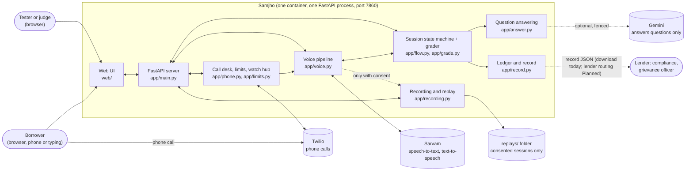
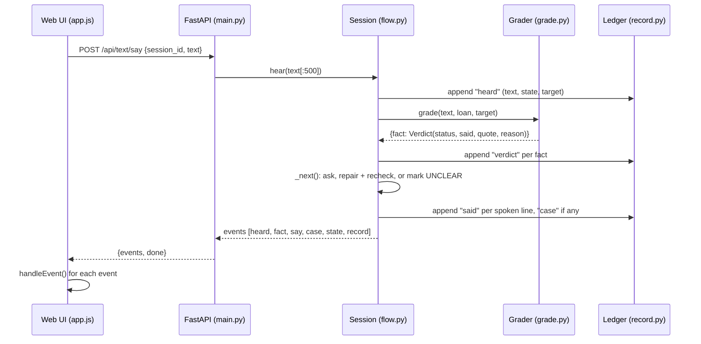
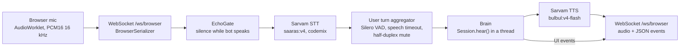
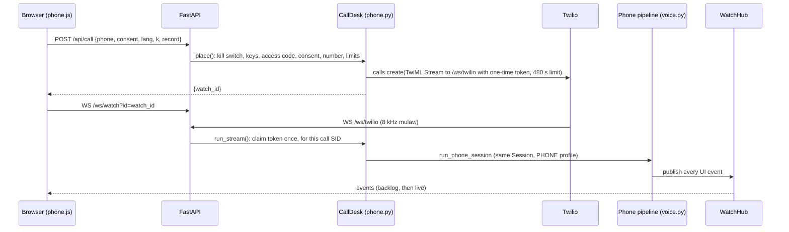
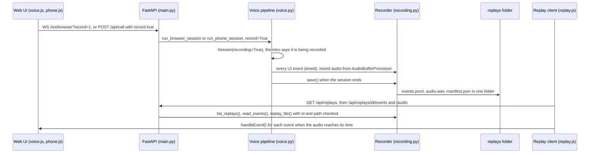

# Samjho: high-level design

Scope: the system as committed in this repository. Anything not built is marked **Planned** with its roadmap
step ([ROADMAP.md](ROADMAP.md)). Module-level detail is in [LLD.md](LLD.md). All loan data is synthetic.

## 1. Principles

### The LLM never decides
Whether a fact is green, amber, red or grey is decided only by deterministic Python in `app/grade.py`, using
tolerances in `app/loan.py`. The conversation order is a state machine in `app/flow.py`. Spoken lines are fixed
templates in `app/lines.py`, filled from the loan. The same input always gets the same verdict, the verdict can
be explained from the code, and grading works with no LLM key.

The voice pipeline is built on Pipecat's LLM-style user aggregator, but its `Brain` processor sends her finished
turn to `Session.hear()` and drops the LLM context frame, so no model is asked to judge anything.

### Gemini may explain, never judge; its numbers are fenced
The only LLM call in the code is in `app/answer.py`, and only for a question she asks during the explanation
that our fixed answers do not cover. Gemini (`gemini-3.5-flash-lite`) sees only the loan's facts. Every number in
its answer must be one of the loan's own numbers (`allowed_numbers`), or the answer is thrown away; "I do not
know" answers are dropped; a 3 s cut-off is enforced on our side. Without a key, or when Gemini fails, the
question is noted for the lender. Gemini output never reaches the grader.

## 2. Context

Solid lines are built and exercised. Dotted lines are optional or planned. The phone path ran on two real calls
on 28 Nov.

## 3. Components

| Component | Files | Responsibility | Status |
|---|---|---|---|
| Web UI | `web/index.html`, `web/app.js`, `web/style.css`, `web/js/voicefield.js`, `web/js/landing.js`, `web/js/livefx.js` | Two views. Landing: a WebGL2 thumbprint (VoiceField shader, SVG fallback) and a four-chamber scroll story (GSAP 3.13.0 ScrollTrigger and SplitText, Lenis 1.3.11, pinned from jsDelivr) ending in the four start options with real disabled reasons, language choice and recording consent. Session: voice-note transcript with English gloss and per-turn reply time, five facts with her first answer kept beside the current verdict and lit on five rings of the print (leader lines, ripples), the figure she said assembling from grains in the verdict colour before it flies into its ring (`livefx.js`, skipped under reduced motion), case badges, the seal closing into one ring, record card with JSON download and the verify command. Every channel renders through one `handleEvent()` | Built |
| Browser voice client | `web/voice.js`, `web/mic-worklet.js` | AudioWorklet captures the mic at 16 kHz PCM16 in 20 ms chunks; plays returned audio gaplessly; sends silence while playing and for 0.3 s after. Two AnalyserNodes in the same AudioContext (each played buffer also feeds Samjho's; the mic source feeds hers through a gate shut whenever the mic sends silence; both into a zero-gain sink) drive the print and the voice-note waveforms (`web/js/voicenotes.js`) | Built |
| Phone client | `web/phone.js` | Form for an Indian mobile number and consent; `POST /api/call` (with `record` when the replay consent box is ticked); follows the call on `/ws/watch` | Built |
| Replay client | `web/replay.js` | Lists replays, plays one's audio and feeds its saved events to `handleEvent()` at their recorded times under a REPLAY badge; seeking re-renders; starting any other tile stops it. The recording plays through an AudioContext into the same two analysers (whose turn it is opens that voice's), its decoded envelope gives every voice note its waveform, and tapping a note seeks there | Built |
| FastAPI server | `app/main.py` | UI and static files, `/healthz`, `/api/status`, typing API, `/ws/browser`, `/api/call`, `/ws/twilio`, `/ws/watch`, `/api/replays`; typing sessions in memory (30-minute idle expiry, at most 200) | Built |
| Settings | `app/config.py` | Optional keys from the environment or `.env`; reports which features are ready and why not, never the key values | Built |
| Session state machine | `app/flow.py` | consent, explain, teachback, check, private, final_consent, done. Emits events; writes every step to the ledger | Built |
| Question answering | `app/answer.py` | Fixed intents, then fenced Gemini, then "noted for the lender" | Built |
| Grader | `app/grade.py`, `app/loan.py` | Assigns spoken numbers to facts by cue words in the same clause, then judges each against the loan with tolerances | Built |
| Number parser | `app/hi_numbers.py` | Hindi, Hinglish, Devanagari, English and digit numbers to values with confusion flags and alternatives; schedule, count and duration. Pure functions | Built |
| Spoken lines | `app/lines.py`, `app/numwords.py` | Every line in Hindi (Devanagari, amounts as words) and English, built from the loan | Built |
| Ledger and record | `app/record.py`, `Session.record()`, `scripts/verify_record.py` | Append-only hash-chained log; record with per-fact results, first-answer and after-Samjho counts, cases, consent and SHA-256 seal | Built |
| Voice pipeline | `app/voice.py`, `app/browser_serializer.py` | One Pipecat 1.17 pipeline, two profiles: browser (16 kHz, half duplex) and phone (8 kHz, barge-in). With consent, an audio buffer after the output records both voices | Built (phone proven on two real calls) |
| Call desk and watch hub | `app/phone.py` | Checks, places the Twilio call with a one-time stream token, runs the phone session, publishes events to the browser watching it | Built (proven on two real calls) |
| Call limits | `app/limits.py` | Per-number, per-IP and global limits, salted hashes, in memory | Built |
| Evaluation | `eval/run_eval.py`, `eval/synthetic.jsonl` | Grades a fixed phrase set; reports accuracy and false passes | Built |
| Recording and replay | `app/recording.py`, `replays/` | With consent, collects every UI event with its time and the mixed audio, masks phone numbers, writes one folder per session; lists and serves replays by checked id | Built. No consented real session saved yet, so the replay tile stays disabled |

## 4. Data flow for one turn

### Typing mode

In the `explain` state, `hear()` calls `app/answer.py` instead of the grader (fixed answer, then fenced Gemini,
then "noted for the lender").

### Browser voice

1. The browser sends PCM16 mono 16 kHz audio as binary WebSocket messages.
2. Half duplex: the browser sends silence while it plays (plus 0.3 s); the server blanks mic audio while
   Samjho speaks (plus 0.25 s) and mutes the user. A plain WebSocket has no browser echo cancellation, so this
   stops laptop speakers being heard as her. She cannot interrupt in the browser.
3. Her turn ends after 0.9 s of silence when a number is expected, 0.6 s in yes/no states.
4. The transcript goes to `Session.hear()` in a worker thread, so a 3 s Gemini wait never stalls audio.
5. All `say` lines of one reply are spoken as one utterance; every event goes to the browser as JSON on the same
   socket; a `latency` event follows each turn.

### Phone call (proven on two real calls)

Phone profile differences: 8 kHz end to end with Pipecat's Twilio serializer; the handset cancels echo, so she
may interrupt, but only with two or more words while Samjho speaks; while a reply that states amounts is read,
she is muted and her audio is blanked before speech-to-text, so the numbers are heard in full. UI events go to the
watch hub, never to Twilio.

### Recording and replay

1. Recording is off unless the person ticks "Save this session as a demo replay. The person speaking agrees to be
   recorded and shown." It applies to the browser voice and the phone; typing is never recorded.
2. Samjho's first line then says the conversation is being recorded with her permission and that she can stop it;
   the screen shows "Recording for a demo replay"; `session_start` in the ledger carries `recording: true`.
3. Events are kept with `t`, seconds since the session started (the clock restarts when the audio recording
   starts, so events line up with the audio), and anything that looks like an Indian
   mobile number is masked to its last four digits before it is kept.
4. At the end, the folder `replays/<UTC date>_<session id>/` is written with `events.jsonl` (one event per line),
   `audio.wav` (both voices mixed to mono, 16 kHz browser, 8 kHz phone) and `manifest.json` (session id, language,
   channel, start time, duration, consent text, spoken consent, facts right first and after Samjho, seal). A
   session in which she never spoke is not saved.
5. The replay tile is enabled only when a `manifest.json` exists. The replay client plays the audio and fires each
   event when the audio passes its `t`, under "REPLAY of a real consented session, recorded <date>. Not live."

## 5. Deployment

| Setting | Where | How | Status |
|---|---|---|---|
| Local | Any machine with Docker | `docker compose up --build`, open http://localhost:7860. Every key is optional (`${VAR:-}` in `docker-compose.yml`) | Built |
| Local without Docker | Python 3.11 | `uvicorn app.main:app --port 7860` (README) | Built |
| Image | `Dockerfile` | `python:3.11-slim-bookworm`, installs `requirements.txt`, copies `app/`, `web/` and `replays/`, honours `$PORT` (default 7860), Python-based `HEALTHCHECK` on `/healthz` | Built |
| CI | `.github/workflows/ci.yml` | Job 1: `pytest`. Job 2: fresh clone, `docker compose up --build` with no keys, wait for `/healthz`, check the main screen and "SARVAM_API_KEY not set" | Built |
| Live link | Railway trial | Same Dockerfile, keys as Railway variables, `PUBLIC_BASE_URL` set to the Railway domain | Planned (step 8), not yet deployed |
| Development tunnel | Cloudflare tunnel from the laptop | Gives Twilio a public https address during development (`scripts/call_smoke.py` docstring); the two real calls on 28 Nov ran through a quick tunnel. Not for judging, because a laptop cannot be trusted to stay up | Development only |

One uvicorn worker: typing sessions, live voice sessions, pending calls, call limits and the watch hub are all
in process memory, and a restart clears them. Consented replays are the only thing written to disk, under
`replays/` (or `SAMJHO_REPLAY_DIR`). The `Dockerfile` copies `replays/` into the image, so committed replays play on the hosted link; a session recorded
inside a hosted container is lost on redeploy unless it is committed.

## 6. Security and privacy

| Area | What the code does |
|---|---|
| Keys | Read from environment or `.env` (gitignored, excluded by `.dockerignore`). `/api/status` names a missing key, never a value (`test_status_never_echoes_a_key`). Tests never call Gemini (`tests/conftest.py`) |
| Personal data | Synthetic sample loan only. No Aadhaar or account number is asked for. Nothing is written to disk except a consented replay |
| Phone numbers | Only `+91[6-9]` plus 9 digits accepted. Kept only as salted HMAC hashes (salt random per process) for the limits; logged masked (`+91XXXXXX1234`) |
| Data sent to providers | Voice audio to Sarvam; call audio through Twilio; when a Gemini key is set, the text of a question not covered by the fixed answers, with the loan's facts, to Google |
| Recordings | Only when the consent box is ticked, and said aloud at the start of the session. Saved events have phone numbers masked to the last four digits (a hex seal or an id is not masked); no keys are part of any event. The manifest keeps the exact consent text and her spoken consent; deleting the folder withdraws it. `.gitignore` excludes `*.wav`, `*.mp3`, `recordings/` and `scratch/`, except `replays/**/*.wav`, which are published on purpose. Synthetic smoke-test replays go under `scratch/` |
| Calls | Consent checkbox required; optional `JUDGE_TOKEN` access code (constant-time compare); `CALLS_ENABLED` read on every request; one-time stream token, valid 120 s and bound to the call SID, so nobody else can attach to a call; calls end after 480 s |
| Abuse limits | Per number 1 call per 30 min and 3 per day; per IP 3 per hour; 2 calls at once and 40 per day overall; owner numbers skip only the per-number and per-IP limits; at most 4 live browser voice sessions, each up to 8 minutes |
| Client IP | Taken from the socket; `CF-Connecting-IP` or `X-Forwarded-For` are trusted only when the request comes from loopback (a local tunnel) |
| Input handling | Typed text truncated to 500 characters. The UI inserts user text with `textContent` or an HTML escape |
| Integrity | Hash-chained ledger; tampering breaks the seal; a browser-written copy still verifies |
| API surface | FastAPI's `/docs` and `/redoc` are turned off. Replay ids must match `^[A-Za-z0-9_-]{1,80}$`, only `events.jsonl`, `audio.wav` and `manifest.json` can be served, and the resolved path must sit directly inside the replay folder |

The private extra-money answer is written to the record as a `HOLD_REVIEW` case and shown on the panel. Routing it
to a lender's grievance officer (and not the field officer) needs lender integration: Planned after Round 2.

## 7. Failure modes and fallbacks

| Failure | What happens |
|---|---|
| `SARVAM_API_KEY` not set | Voice and phone tiles disabled with the reason; `/ws/browser` sends a `KEY_NOT_SET` notice and closes; typing works |
| `GOOGLE_API_KEY` not set | Questions get fixed answers or "noted for the lender"; grading is unaffected (always rules-only) |
| Gemini slow, failing, or answering with a number not in the loan | Answer dropped after 3 s or on the fence check; the question is noted for the lender |
| Twilio keys, `PUBLIC_BASE_URL` or `CALLS_ENABLED` missing | Phone tile disabled with the reason; `/api/call` refuses with 503 (not set up) or 403 (paused) |
| Call limit reached | `/api/call` returns 429 with a plain reason (cooldown, daily cap, network, concurrency) |
| Twilio refuses the call | 502 with Twilio's message; the limit slot is released |
| Call not answered within 120 s | Token expires, slot released, watcher told "not answered" |
| Wrong or reused stream token | `/ws/twilio` closes with code 1008 |
| Unknown watch id | `/ws/watch` sends `WATCH_UNKNOWN` and closes |
| Too many voice sessions | `/ws/browser` sends a `BUSY` notice and closes |
| Browser leaves, or 8 minutes pass | The session's pipeline is cancelled; a consented recording is still saved |
| Recording cannot be saved | Logged; the session and its record are unaffected |
| Unknown or unsafe replay id | `/api/replays/{id}/events` or `/audio` returns 404 |
| No consented replay saved yet | Replay tile disabled with "No recorded test session added yet"; refused calls say "Typing still works." instead of offering replay |
| Latency clock started before the turn | The reading is dropped instead of shown (`voice.plausible_latency`) |
| Number word unclear | The parser skips unreadable words and flags confusion pairs. `judge()` returns amber "unclear word, confirm" only if the other reading would change the status, and she is asked again. "pachaas hazaar" for cash in hand is red: 50,000 and 55,000 are both wrong |
| Fact still wrong after 2 repairs | UNCLEAR, CALLBACK case, flow continues; the loan is never blocked |
| Unrecognised yes or no | "Sorry, I did not catch that", same state |
| Sarvam down during a session | No specific handling yet. Planned: tell her and offer typing mode |
| Session expired or server restarted | `/api/text/say` returns 404 "session expired, start again"; in-memory state is lost on restart |
| Whole service down | Nothing depends on Samjho to disburse: the lender's existing acknowledgement remains the fallback |
